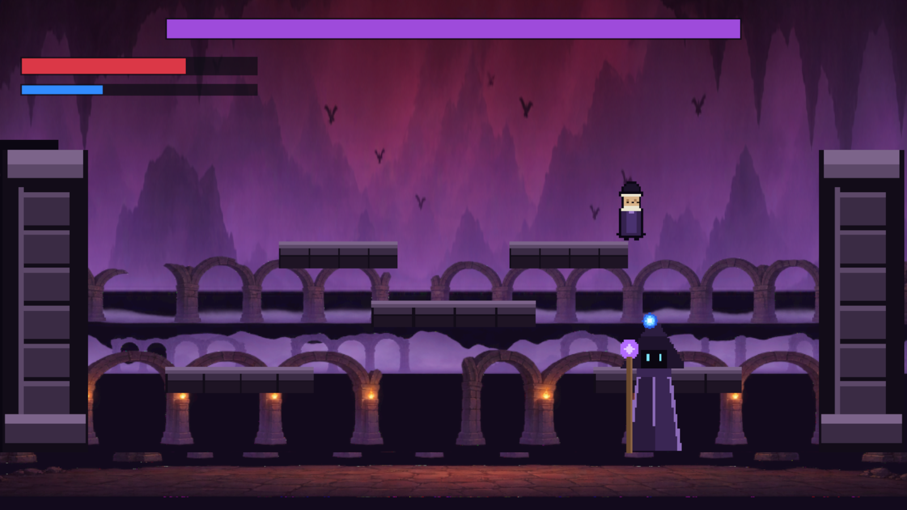

# Mundo Vazio — Corredor + Arena (Unity 2D)

### Personalização da arena (`Assets/Arena` + `ArenaDoVazio_Tecnico`)

O piso e a decoração da arena são compostos a partir do **atlas transparente** do pacote
técnico (`ArenaDoVazio_Tecnico/Atlas/ArenaDoVazio_Atlas_Transparente.png`), seguindo a foto
de referência. As peças foram recortadas do atlas para `Assets/Vazio/Art/Arena/` (43 PNGs,
fundo transparente) e aplicadas pelo menu **Vazio ▸ Arena ▸ Vestir Arena (atlas ArenaDoVazio)**
(`ArenaDresser`). O fundo e os pilares **não** são alterados.

| Elemento | Peças do atlas | Onde |
|---|---|---|
| Piso | `wall_a/b/c/d/e` | faixa de tijolos, 13 painéis de 2,1 u (y −1,05) |
| Faixa do topo | `wall_*` (9 painéis) + `jag_a/b/c` | y 10,75 (banda de tijolos com buracos) |
| Estandartes | `banner_a/b` + `hanger` | x 86,2 / 99,8 / 93 |
| Colunas com estátuas | `column_a/b` + `statue_l/r` | x 82,35 e 104,3 |
| Cemitério | `tree`, `grave_*`, `cross_*`, `fence`, `gate`, `rock_*`, `rubble` | lados esquerdo/direito |
| Rochas flutuantes | `rock_a/b/c/d` | céu (y 7,5–9,4, ordem −40), girando no eixo Z com `FloatingRock` (2–9 °/s, sentido e velocidade aleatórios por pedra) e alfa 0,55–0,72 para dar profundidade |
| Braseiros | `brazier` + chama `spr_torch` | x 82,9 e 103,1 |
| Fogo | `Assets/Arena/spr_torch.png` (4 quadros, 10 fps) | sobre os braseiros |

Os recortes automáticos que já existiam no atlas não cobriam todas as peças (árvore, estátua,
coluna), por isso o pipeline exporta os retângulos medidos para PNGs próprios — o `ArenaDresser`
carrega dessa pasta (filtro Point) e escala cada peça para o tamanho desejado em unidades.


Implementação da fase final do GDD ("O Vazio") como um projeto Unity 2D (URP, Universal 2D)
montado a partir do cenário pré-moldado em `scenesMVP/Vazio` (a pasta **base** de referência).

- **Cena principal:** `Assets/Vazio/Scenes/Vazio.unity` (primeira na Build Settings)
- **Editor:** Unity 6000.5.9f1 (Universal 2D)
- **Scripts:** `Assets/Vazio/Scripts`
- **Construtor da cena:** `Assets/Vazio/Editor/VazioLevelBuilder.cs` (menu **Vazio ▸ Construir Cena do Vazio (2D)**)


---

## 1. Level design

```
 x = -8 ─────────────── 77 ──── 80 ───────────── 106
 |      CORREDOR (85 u)     |  PORTAL  |   ARENA (26 u)   |
 piso y = 0, teto y = 12      arena fechada 26 x 12
```

- **Corredor:** ~85 unidades sem mobs, camadas de parallax (back / far / middle / near),
  piso em Tilemap e colisores estáticos.
- **Portal:** parede escura fechando o corredor, com um grande arco de pedra mergulhado
  em escuridão total (trigger de transição).
- **Chefe:** o Arquivista fica **desativado** até o jogador atravessar o portal; a arena
  começa vazia e silenciosa.
- **Arena:** coliseu sombrio fechado (céu roxo, arcos, pilares, colunas com tocha),
  piso sólido, teto, **pilares visíveis com colisão nas duas bordas** e
  **5 plataformas flutuantes one-way**.

## 2. Inconsistências encontradas no material "base" e correções aplicadas

| Problema no cenário original (`abyss.unity`) | Correção |
| --- | --- |
| Arena (céu, arcos, pilares, piso) em **x ≈ -51 a -77**, atrás do início do corredor. | Arena reposicionada ao fim do corredor (x = 80 a 106). |
| Escalas arbitrárias (céu 0.1×0.4, piso 0.2×0.2, pilares 2.25×5.5). | Cada camada dimensionada por **tamanho-alvo em unidades**. |
| Nenhum colisor 2D: piso apenas visual. | Pisos, paredes, teto, pilares e plataformas com `BoxCollider2D`. |
| `PlayerController` **não existia**; câmera com `CameraTestMovement` e "jogador" estático. | `PlayerController` e `CameraFollow2D` novos; jogador com Rigidbody2D real. |
| Câmera em (101, 0) sem alvo. | Câmera ortográfica com follow e trava na arena. |
| Duplicação de tochas (`Torch`/`SecondTorch` no mesmo ponto). | Cena reconstruída sem duplicatas. |
| Texturas de 2132 px importadas com `maxTextureSize` 2048. | Importador em 4096, sem compressão nos fundos. |
| Faixa de piso da arte do corredor acima do piso físico. | Camadas escaladas para 14,5 u e deslocadas para alinhar a arte ao piso. |
| Arte do corredor aparecendo através das áreas transparentes da arena. | Fundo sólido (#120A1C) atrás da arena e piso do corredor em -69. |

## 3. Câmera (`CameraFollow2D`)

- Ortográfica, tamanho 5,2 no corredor, segue com `SmoothDamp` + antecipação de 1,8 u.
- Limite horizontal do corredor: x = 1 … 74.
- Ao cruzar `arenaTriggerX = 78` (ou por `SnapToArena()`, usado pelo portal) trava no
  enquadramento da arena — centro (93, 6), tamanho ortográfico calculado para cobrir
  26 × 12 em qualquer proporção de tela — e **não se move mais**.

## 4. Controlador (`PlayerController.cs`)

| Ação | Entrada | Implementação |
| --- | --- | --- |
| Andar | **A / D** | Aceleração/desaceleração no chão e no ar, 7 u/s. |
| Pulo | **Espaço** | Altura **fixa** (3,1 u): `v = sqrt(2·g·h)`, independe de segurar. Coyote 0,1 s + buffer 0,12 s. |
| Dash | **Shift** | 3,6 u em 0,16 s, **no ar**, **custa 20 de mana**, **sem recarga**, invencível durante (+0,06 s) e **atravessa inimigos e disparos**. |
| Agachar | **S** (segurar) | Altura do `BoxCollider2D` **pela metade** (1,8 → 0,9) enquanto a tecla estiver pressionada; ao soltar, o collider **volta a 1,8 no mesmo frame** (se não houver teto). |

> O agachar é **estritamente "segurar"**: `UpdateCrouch()` roda todo frame, lê
> `Keyboard.current.sKey.isPressed` (equivalente a `Input.GetKey` no Input System novo,
> que é o handler ativo do projeto) e restaura o tamanho original assim que a tecla é solta.
> Um guarda idêntico existe no `FixedUpdate`, para o caso de um frame de `Update` ser pulado.

Componentes no GameObject `Player`: `Rigidbody2D` (gravityScale 3,2, **Freeze Rotation Z**,
interpolação, detecção contínua, `NeverSleep`), `BoxCollider2D` 0,8 × 1,8 e `PlayerController`.
O sprite fica no filho `Visual`.

### Animações do jogador (pacote `Assets/Player`)

O Bibliotecário usa as tiras de `Assets/Player/Sprites/Player` (frames de 128×128 já fatiados
no pacote, PPU 36, pivô nos pés) tocadas por `PlayerVisualAnimator`:

| Situação | Clipe |
| --- | --- |
| Parado | `Idle` (10 fps, loop) |
| Andando | `Run` (12 fps, loop) |
| Agachado andando | `Walk` (10 fps, loop) |
| No ar | `Jump` |
| Atirando magia | `Attack_2` (0,3 s) |
| Levando dano | `Hurt` (0,25 s) |
| Morrendo | `Dead` (até renascer) |

A hierarquia é `Player → Visual (raiz) → Sprite (pivô nos pés, y = -0,9)`, então o agachar
reduz a escala da raiz e os pés continuam apoiados no chão. O projétil da magia usa o sprite
`Magic_sphere` do mesmo pacote.

> Os sheets do pacote vinham com recortes e pivôs diferentes (o `Run`, por exemplo, vinha
> com recorte justo e pivô no centro), o que fazia o personagem **afundar no chão ao correr**.
> O construtor agora re-fatia todos os sheets numa grade uniforme de 128×128 com pivô nos pés,
> então Idle, Run, Walk, Jump e ataques compartilham o mesmo alinhamento.

## 5. Renderização — o jogador sempre à frente

- Sorting Layer dedicada **`Player`** (criada automaticamente pelo construtor da cena) e
  **Order in Layer 500** no `SpriteRenderer` do jogador.
- Todo o cenário fica na camada `Default` com ordens negativas (fundos de -100 a -60,
  pilares -20, plataformas -30, piso -35). O jogador nunca é coberto por nenhum elemento.

## 6. Limites da arena

- **Pilar esquerdo** em x = 80,6 e **pilar direito** em x = 105,4, ambos visíveis (arte
  `pillar.png`, 2,6 × 9,2 u) e com `BoxCollider2D` do mesmo tamanho.
- Eles coincidem com as bordas do enquadramento travado da câmera (79,2 … 106,8), então o
  jogador vê a barreira física em vez de uma parede invisível.

## 7. Plataformas flutuantes

- 5 plataformas (arte `platform.png`, 0,8 u de espessura) em (86,5 / 99,5 → topo 2,6),
  (93 → topo 4,6) e (89,5 / 96,5 → topo 6,4).
- Cada uma tem `BoxCollider2D` com `usedByEffector = true` e `PlatformEffector2D`
  (`useOneWay = true`, `surfaceArc = 180`, sem fricção/ricochete lateral): dá para
  atravessar por baixo e pousar por cima, com o pulo fluindo normalmente.
- Todas as alturas são alcançáveis com a altura de pulo de 3,1 u.

## 8. Portal corredor → arena

1. O corredor termina na **parede de escuridão** (x = 77) com o **portal roxo** do pacote
   `Assets/Portal` animado: a **primeira fileira do sheet** (8 quadros) roda em loop a 8 fps
   via `SpriteLoopAnimator`. Como cada quadro tem recorte e posição diferentes no sheet,
   o construtor re-fatia os 8 desenhos com **pivô no pé de cada um**, então o portal
   "respira" apoiado no chão sem pular (≈4,1 × 6,1 u).
2. `Trigger_Portal` (`BoxCollider2D` **Is Trigger**, 2,4 × 6,0 u) carrega o
   `PortalTransition`.
3. Ao entrar: **fade to black** (Canvas Screen Space Overlay + `CanvasGroup`, 0,55 s),
   teleporte instantâneo para `Spawn_Arena` (x = 84), `CameraFollow2D.SnapToArena()`
   (câmera travada no enquadramento da arena), **ativação do Arquivista** (que fica
   desativado no início da cena) e **fade in** (0,7 s).
4. Durante a transição o `PlayerController` é desligado e o `Rigidbody2D` pausado
   (`simulated = false`), evitando queda/movimento durante o preto.

## 9. Validação executada (Editor ao vivo, Play Mode)

| Verificação | Resultado |
| --- | --- |
| `unity recompile` | `up_to_date`, **0 erros / 0 avisos** |
| Agachar (S pressionado) | `BoxCollider2D.size.y` 1,8 → **0,9**, `IsCrouching = true` |
| Soltar S | collider volta a **1,8**, escala visual volta a 1,0 |
| Andar (D) | x 30 → 44,3 em ~2,4 s e desaceleração até 0 |
| Pulo | y 0,93 → **3,89** (≈3,0 u acima do solo) |
| Dash | invencível, +3,88 u, cooldown ≈1,46 s após o uso |
| Pousar em plataforma | queda de y=6 → repouso em **3,53** (topo 2,6 + 0,9), `IsGrounded = true` |
| Portal | jogador em 77,5 → **83,8** (spawn da arena), câmera em 93, `IsLockedInArena = true`, alpha do fade volta a 0 |
| Sorting | `sortingLayerName = "Player"`, `sortingOrder = 500`; sprite do jogador desenhado sobre o pilar (ordem -20) |
| Console | sem erros |

## 10. Como usar

1. Abra o projeto `jogo` no Unity Hub (editor 6000.5.9f1).
2. Abra `Assets/Vazio/Scenes/Vazio.unity` (primeira da Build Settings).
3. Play. Controles: A/D, Espaço, Shift, S.
4. Para regenerar a cena: menu **Vazio ▸ Construir Cena do Vazio (2D)**
   (ou `-executeMethod Vazio.EditorTools.VazioLevelBuilder.Build`).


## 11. Ataque do jogador (PlayerCombat)

- **Entrada:** Botão Esquerdo do Mouse **ou** tecla **J**.
- **Cadência:** 0,3 s entre disparos (o disparo sem mana não consome a janela).
- **Custo:** 10% da barra de mana (100 pontos, recarga total em 15 s).
- **Auto-aim:** mira no inimigo vivo mais próximo dentro de 30 u (rotação inicial +
  leve correção de rota do projétil).
- **Magia azul** (`MagicProjectile.prefab`): voa em linha reta a 17 u/s, é destruída ao
  acertar inimigos, chão, paredes/plataformas ou ao percorrer 30 u.
- **Mana zerada:** o jogador fica lento até recuperar 10% (punição do GDD).
- **Prefab do projétil:** qualquer prefab de magia serve. O `PlayerCombat` normaliza o
  objeto instanciado (adiciona `MagicProjectile`, Rigidbody2D kinematic, collider trigger,
  sorting layer `Player`) e desliga scripts de projétil concorrentes — assim o
  `Spell_2.prefab` do pacote funciona sem precisar de ajustes manuais.

## 12. O Arquivista (ArchivistBoss)

Instanciado na arena (x = 99) com `Rigidbody2D` + `BoxCollider2D` (1,6 × 3,3) e
**100 de vida**. Máquina de estados rígida — **um ataque por vez**:

```
Idle ──▶ Books ──▶ Idle        Laser: a cada 20 s
  │──▶ Laser ──▶ Idle          Livros: aleatório 5–10 s
  │──▶ Melee ──▶ Idle          Melee: jogador a ≤ 2,4 u, no chão
  └──▶ PhaseChange ──▶ Idle    Fase 2 em 50% da vida
```

- **Prioridade:** os três cronômetros (Laser, Livros, Poças) correm **sempre**, inclusive
  durante melee/livros — antes só corriam no Idle, então o chefe que ficava em melee nunca
  chegava aos especiais.
- **Peso dos ataques:** Laser (pesado) > Livros > Melee. Quando dois especiais vencem juntos,
  o **Laser** roda e os **Livros entram na fila** (`QueuedAttack`), disparando **2 s**
  (`attackQueueDelay`) depois do fim do Laser. Melee só acontece quando nenhum especial está
  pronto — assim ele não “engole” mais os golpes especiais.

### Arte e animações (pacote do projeto)

O boss usa os sprites de `Assets/Arquivista do vazio/Sprites` (tiras de 250×250 px,
PPU 20, fatiadas pelo construtor em `BossVisualAnimator`):

| Estado do boss | Clipe |
| --- | --- |
| Idle parado | `Idle` (8 fps, loop) |
| Andando | `Run` (12 fps, loop) |
| Ataque de perto | **`Attack2`** (14 fps) |
| Laser | `Attack1` |
| Livros: subindo / flutuando / descendo | `Jump` / `Idle` / `Fall` |
| Levar dano | `Take hit` |
| Morte | `Death` |

Os livros usam os sprites de `Assets/Livros` (grades 4×4 de 32×32, PPU 32): cada livro
sorteia uma das nove cores do pacote.

### Perseguição e golpe (attack2)

Enquanto **não há golpe em andamento** (estado `Idle`), o Arquivista **caminha na direção
do jogador** a 2,4 u/s, respeitando os limites da arena. Ao chegar a ≤ 2,4 u ele para,
toca a animação **Attack2** e aplica o golpe (3 de dano); depois de 1,4 s de intervalo
ele pode golpear de novo.

### Laser Roxo (20 s)
Feixe horizontal rasteiro na altura 1,25 u (faixa 0,975–1,525): atinge quem está em pé
(collider até 1,8) e **passa por cima de quem está agachado** (collider até 0,9).
Cura por 0,6 s, ativo 0,9 s, recuperação 0,35 s. Fere **uma única vez** por feixe (3 de dano).

### Livros Giratórios (5–10 s)
O boss salta, **zera a gravidade e flutua** (física pausada), instancia 5 livros a partir
da ponta do cajado, cada um com **cor aleatória** (HSV) e rotação, voando na direção do
jogador. O boss **só desce quando todos os livros desaparecem** (ou no timeout de 12 s).
Os livros são destruídos ao colidir com a magia do jogador, o chão, as plataformas ou o
jogador (2 de dano). O boss ignora as plataformas para sempre pousar no chão da arena.

## 13. Fase 2 — Poças Corrompidas

Ao chegar a **50% da vida**, o Arquivista entra em Fase 2 (1 s de invulnerabilidade e
flash). Ele mantém Laser e Livros e passa a invocar, **a cada 15 s**, 3 poças no chão
centradas em **onde o jogador está pisando**.

- Cada poça vive **exatamente 5 s** e desaparece com **fade no alpha** nos últimos 1,5 s.
- Pisar causa **lentidão (0,45×)** e **1 de dano a cada 0,8 s**.

## 14. HUD

- Barra de **vida** (vermelha) e **mana** (azul) no canto superior esquerdo.
- **Barra grande do chefe** no topo central, que desaparece suavemente quando ele morre.
- Canvas `Canvas_HUD` (Screen Space Overlay) criado pelo construtor da cena.

## 15. Validação executada (Editor ao vivo, Play Mode)

| Verificação | Resultado |
| --- | --- |
| `unity recompile` | `up_to_date`, **0 erros / 0 avisos** |
| Disparo (J) | mana 100 → **90**, 1 projétil criado, cooldown ≈ 0,20 s restante |
| Dano da magia no boss | 100 → 94 por acerto (6 de dano) |
| Laser em pé | vida 10 → **7** (um acerto de 3) |
| Laser agachado | vida **10 → 10** (o feixe passa por cima) |
| Máquina de estados | ciclos observados: Idle → Books → Idle → Laser → Idle, sem sobreposição |
| Prioridade do Laser | Laser inicia e `QueuedAttack = Books` |
| Fila de ataques | Livros começam **2,01 s** depois do fim do Laser |
| Dash custa mana | mana 100 → 80 por dash, sem recarga (limitado só pela mana) |
| Dash atravessa o chefe | jogador em 84,47 cruza o chefe (86,78) e chega a 88,51 |
| Dano durante o dash | `TakeDamage(2)` durante o dash não tira vida; depois do dash tira |
| Fase 2 | vida 45 ⇒ `IsPhaseTwo = true`, poças máx. **3** em campo |
| Poça | lentidão **0,45×**, dano periódico, some após 5 s |
| Books | 5 instanciados por ataque; destruídos por plataformas/magia |
| Melee | jogador a 1,9 u ⇒ estado Melee, vida 10 → **4** |
| Morte do boss | vida 0 ⇒ estado Dead, collider desligado, objeto desativado após o fade |



## 16. Como usar

1. Abra o projeto `jogo` no Unity Hub (editor 6000.5.9f1).
2. Abra `Assets/Vazio/Scenes/Vazio.unity` (primeira da Build Settings).
3. Play. Controles: **A/D** andar, **Espaço** pular, **Shift** dash, **S** agachar,
   **Mouse Esquerdo / J** atacar.
4. Para regenerar a cena: menu **Vazio ▸ Construir Cena do Vazio (2D)**
   (ou `-executeMethod Vazio.EditorTools.VazioLevelBuilder.Build`).

## 17. Limitações conhecidas / próximos passos

- Sprites do Bibliotecário, do Arquivista, dos livros, da magia e das poças são
  **placeholders** gerados para o protótipo.
- O portal é unidirecional (corredor → arena), como pedido.
- Ainda não há checkpoints, telas de vitória/derrota, áudio ou a Página Brilhante do GDD.
- Nenhum pacote pago da Asset Store foi usado; toda a arte nova foi gerada no projeto.

## HUD (interface)

O HUD usa o pacote `Assets/UI/ArenaDoVazio_HUD_Tecnico_Unity` (moldura + fundo + fill + ícone),
aplicado pelo menu **Vazio ▸ UI ▸ Pintar HUD (assets)** (`HudDresser`). O script só mexe no
`Canvas_HUD` — nenhum outro objeto da cena é alterado — e mantém as barras antigas desativadas
como fallback.

| Barra | Peças | Posição |
|---|---|---|
| Vida do jogador | `Health_Frame/Background/Fill/Icon` | canto superior esquerdo, escala 0,82 |
| Mana do jogador | `Mana_*` | abaixo da vida |
| Vida do Arquivista | `Archivist_*` | abaixo da mana (aparece só quando o chefe entra) |

- `Fill` é `Image.Type.Filled` (Horizontal, Left) e recebe `HealthNormalized` / `ManaNormalized` /
  `HealthNormalized` do chefe pelo `GameHud`.
- A barra do chefe fica num `CanvasGroup` com alfa 0 até o Arquivista ser ativado (portal).
- Texturas importadas com PPU 32, filtro Point, sem compressão e sem mipmaps.

Antes de pintar o HUD, a cena foi salva em `docs/backups/Vazio_20261117_104251.unity`.

## Poças de ácido (fase 2)

O pacote `Assets/Pocas` define o visual das poças, aplicado pelo menu
**Vazio ▸ Poças ▸ Aplicar Acid VFX** (`PuddleDresser`).

| Asset | Uso |
|---|---|
| `Acid VFX 01` (16 quadros 32×32, PPU 32) | **projétil de ácido** que o Arquivista arremessa |
| `Acid VFX 02 Repeatable` (12 quadros 56×32) | poça no chão, animação em loop (8 fps) |
| `Acid VFX 02 Ending` (6 quadros 56×32) | animação de sumiço (10 fps), nos últimos 0,6 s |

**Fluxo:** em `SpawnPuddles()` o chefe instancia `AcidProjectile.prefab` no cajado e chama
`LaunchTo(alvo, ~0,65 s)`, que calcula a parábola com a gravidade do próprio projétil. Ao
tocar o chão (`groundY = 0`) o projétil cria o `CorruptedPuddle.prefab` naquele X e se
destrói. A poça então:

1. anima em loop (`repeatFrames`, 12 quadros) durante ~4,4 s;
2. troca para `endingFrames` (6 quadros) no último 0,6 s;
3. é destruída aos 5 s.

O `CorruptedPuddle` mantém intactos os efeitos de jogo (lentidão 0,45× e 1 de dano a cada
0,8 s), e o visual agora fica num filho `Visual` (escala 1,5) para a arte do ácido encostar
no piso sem mexer no colisor de 4 × 1,25.

> Os sheets do Acid VFX 02 são tiras **verticais**: 384 px e 192 px de altura com quadros de **32 px**
> (12 e 6 quadros). Fatiar em 64 px juntava dois quadros no mesmo sprite e a poça aparecia
> "duplicada", uma em cima da outra.

**Validação:** um disparo gerou 3 projéteis → 3 poças; a sequência de sprites foi
`PuddleRepeat_00…05` em loop, depois `PuddleEnd_00 → 01 → 02` e o objeto foi destruído em 5,0 s.
